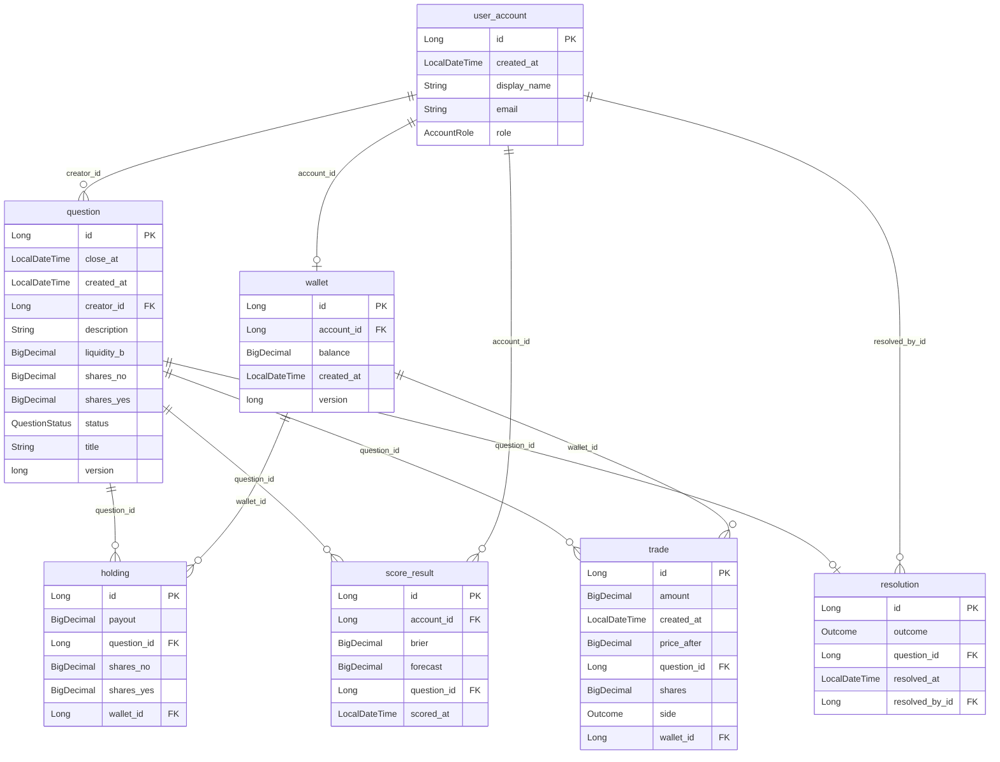

# Schemat bazy danych

Plik generują reguły projektu (panel Maven → Lifecycle → verify). Nie edytujcie go ręcznie.

Tabele: 7 · kolumny: 46 · relacje: 8 × @ManyToOne, 1 × @OneToMany, 2 × @OneToOne, 0 × @ManyToMany

| Tabela | Encja | Kolumny | Klucze obce |
|---|---|---|---|
| holding | Holding | 6 | question_id, wallet_id |
| question | Question | 11 | creator_id |
| resolution | Resolution | 5 | question_id, resolved_by_id |
| score_result | ScoreResult | 6 | account_id, question_id |
| trade | Trade | 8 | question_id, wallet_id |
| user_account | UserAccount | 5 | — |
| wallet | Wallet | 5 | account_id |

